# Codeer

CodeBuddy IDE 的 macOS 菜单栏伴生工具：**等待确认时刘海弹卡 + 卡上直接操作 + 账号无感切换 + 会话同步 + 积分看板**。

- 纯 Swift Package 实现（SwiftUI），无 Xcode 工程
- 菜单栏常驻，经 CDP（Chrome DevTools Protocol）与 CodeBuddy 通信

## 兼容版本

- CodeBuddy CN **4.12.x**（已在 4.12.1 / 4.12.2 实测）
- 仅在 **macOS 27.0.1**（作者本机）实测；`Package.swift` 声明最低 macOS 13，旧系统未验证
- 检测与代点依赖 CodeBuddy 聊天面板的 DOM 结构（`menu-item`、`optionText` 等），IDE 大版本更新后需回归验证

## 功能

### 审批弹卡（M1）

- Agent 等待确认 / 提问时，在刘海下方弹出卡片，跨 Space / 全屏可见
- 卡上直接操作：运行 / 拒绝 / 跳过确认框；多问题卡分题作答、自定义输入（跳转 IDE 聚焦输入框）
- 选择题两种交互：单选题即点即答；**多选题勾选后点「提交（N 项）」一次性代点 + 提交**（自动对齐 IDE 侧已勾选状态，支持单题多选与多题卡混排）
- 处理成功后自动激活 CodeBuddy 窗口
- 支持多窗口（每个聊天 webview 独立连接，自动跟随窗口变化）
- 带自愈：派发失败自动重试（至多 3 次）后走 click 兜底

### 账号切换（M2）

- 菜单实时显示当前账号状态，多账号一键切换
- 切换通过 CodeBuddy 官方认证服务完成，**无感不重启**，失败自动回滚
- 支持备份当前账号（会话 JSON 原样保存，0600 权限）

### 会话同步（M2）

- 把 A 账号的历史会话复制到 B 账号（独立浮窗，多选）
- 血缘去重：同一会话重复同步走更新而非新增副本；副本带 `originalId` 标记来源

### 积分看板（M3）

- 各账号积分余额 / 已用量 / 用量进度条，多账号合并总积分
- 30 天内过期积分提醒
- 用量统计：按日柱状图（近 7 / 30 天切换）+ 按模型 Top 排行
- 打开面板或点刷新按钮时实时查询，各账号凭快照 token 直查、批量并发，无需切账号

## 工作原理

CodeBuddy 必须以**调试模式**启动，Codeer 依赖两个端口：

| 端口 | 用途 |
|---|---|
| CDP 9224 | 聊天面板监视（审批框 / 问题卡检测与代点） |
| Node inspector 9244 | 主进程上下文（账号切换、会话数据读写） |

- 检测：向聊天 webview 注入绑定 + MutationObserver，1s 轮询兜底，断线自动重连
- 代点：换算全链偏移后在对应 target 会话派发可信鼠标事件（`Input.dispatchMouseEvent`）
- 账号切换：经 9244 沿闭包链定位官方认证服务，调 `storeSession` 换会话并广播
- 积分接口：`workbuddy.cn` 的 billing meter 接口（余额分段 + 分页用量）

## 构建与运行

```bash
# 构建（必须显式指定 SDK）
xcrun -sdk macosx26.5 swift build

# 启动 / 管理（~/.local/bin/codeer）
codeer            # 启动（自动生成 .app bundle，LaunchServices 模式）
codeer --stop     # 退出
codeer --status   # 进程 + 端口 + 最近日志
codeer --log      # 跟踪日志（/tmp/codeer-run.log）
codeer --relaunch # 以调试模式重启 CodeBuddy
codeer --rebuild  # 重新编译并重启
codeer --rebuild-app  # 重新生成 .app bundle 并重启
```

CodeBuddy 侧（~/.local/bin/codebuddy）：

```bash
codebuddy          # 以调试模式启动 CodeBuddy（普通方式启动无调试端口，Codeer 无法工作）
codebuddy --stop   # 退出（超时 8s 自动强杀）
codebuddy --status # 查看端口状态
```

启动顺序不限：Codeer 与 CodeBuddy 谁先启动都可以，Codeer 自动重连。

## 版本演进

| 版本 | 方案 | 结果 |
|---|---|---|
| v1 原生 | AX 树 / CGWindowList 检测审批按钮 | 聊天面板 webview 未暴露无障碍树，按钮级检测不可行；交付了 Stop 完成提醒 |
| v2 hook | CodeBuddy 官方 Hooks（`nudge_hook.py`、`python-bak/`） | PreToolUse 在 IDE 批准之后才触发，不能做确认卡；Stop 钩子可用作完成提醒 |
| v3 CDP（当前） | 参考 WorkDaddy，CDP 直连聊天面板与主进程 | 审批弹卡、代点、账号切换、会话同步、积分看板全部实现 |

### 关键实测结论

- 审批下拉项是 `div.menu-item`（不是 button），选择器必须含 `.menu-item`
- 多问题卡选项按钮无 `role=button`，稳定锚点是 optionText 的直接父元素（两种卡通吃）
- 多选题题头带 `multiBadge`，选中态是选项元素追加 `selected` 类（勾选不提交，纯本地状态），必须点 footer 的 continueBtn 提交（全部题答完前 disabled）；多题卡里的单选题同样是 toggle——代点重试前必须先探选中态，盲点会翻转勾选
- 确认浮层渲染在父页面文档（须主页面会话派发）；问题卡选项渲染在聊天 webview 文档（须聊天 target 会话派发）——`dispatchEvent` 一律被 `isTrusted` 过滤，必须 CDP 输入事件
- `CDPClient.send` 返回整条消息 `{id, result:{...}}`，取字段前必须先剥一层 `result`
- 调试端口只有调试模式启动才存在，IDE 重启后必须经 `codebuddy` / `codeer --relaunch`

## 目录结构

```
Sources/Codeer/
├── main.swift                     入口（--selftest / --cdp-probe）
├── AppDelegate.swift              菜单栏、菜单、面板调度
├── ApprovalMonitor.swift          审批/问题卡监视（多线程加锁、snapshot）
├── CDPClient.swift                CDP WebSocket 客户端
├── CDPDiscovery.swift             CDP target 发现与多窗口跟随
├── NativeAuth.swift               9244 闭包链定位官方认证服务、账号切换
├── AccountStore.swift             账号备份/读取
├── SessionSync.swift              会话复制（血缘去重）
├── SessionSyncPanelController.swift  会话同步浮窗
├── CreditService.swift            积分/用量接口
├── CreditPanelController.swift    积分看板浮窗
├── PanelController.swift          刘海卡片 UI
├── AXInspector.swift              AX 树遍历（窗口聚焦，v1 遗留）
├── WindowFocus.swift              按项目名聚焦对话窗口
└── DeerPNGAsset.swift             菜单栏图标素材（方块+鹿字镂空 template）
tools/                             codeer / codebuddy 启动脚本（历史存档）
python-bak/                        v2 hook 版验证脚本（已归档）
nudge_hook.py                      v2 的 Stop 钩子脚本（已归档）
```

## 调试

- `swift run Codeer --selftest` — 无 GUI 自检
- `swift run Codeer --cdp-probe` — CDP 连接排查
- 日志：`codeer --log`（`/tmp/codeer-run.log`）

## 截图

**危险命令审批 / 后台对话待处理**（Codeer 刘海卡，卡上直接操作）：

| 危险命令提示弹卡 | 后台对话待处理弹卡 |
|---|---|
| 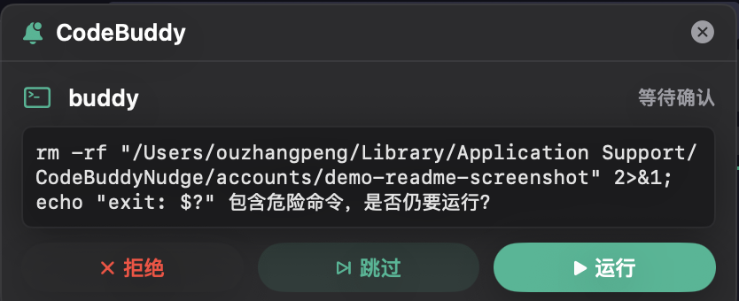 | 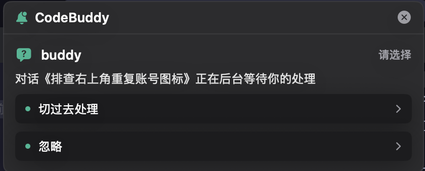 |

**单问题选择**（左：CodeBuddy IDE 内弹框，右：Codeer 刘海卡即点即答）：

| CodeBuddy IDE | Codeer |
|---|---|
| 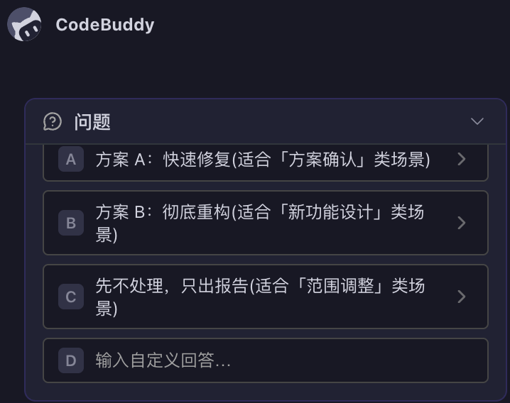 | 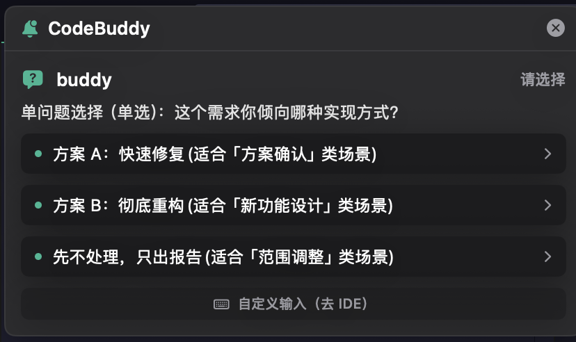 |

**多问题卡 · 单选**（分题作答，每题一张卡）：

| CodeBuddy IDE | Codeer |
|---|---|
| 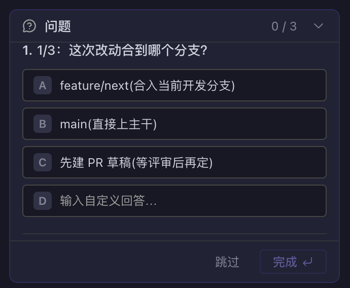 | 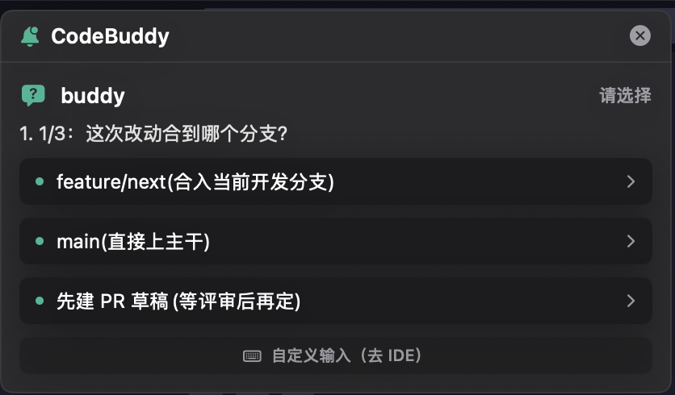 |

**多问题卡 · 多选**（选项行 toggle 勾选，点「提交（N 项）」一次性代点并提交，支持与其他题型混排）：

| CodeBuddy IDE | Codeer |
|---|---|
| 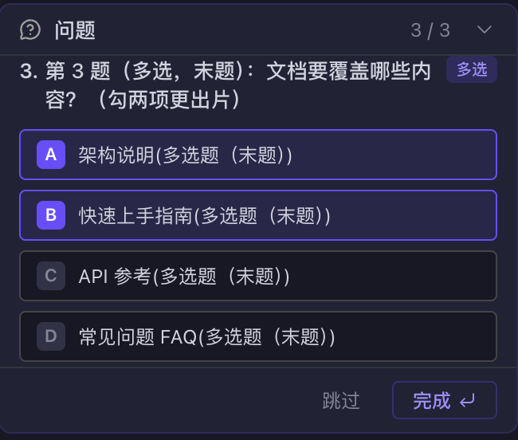 | 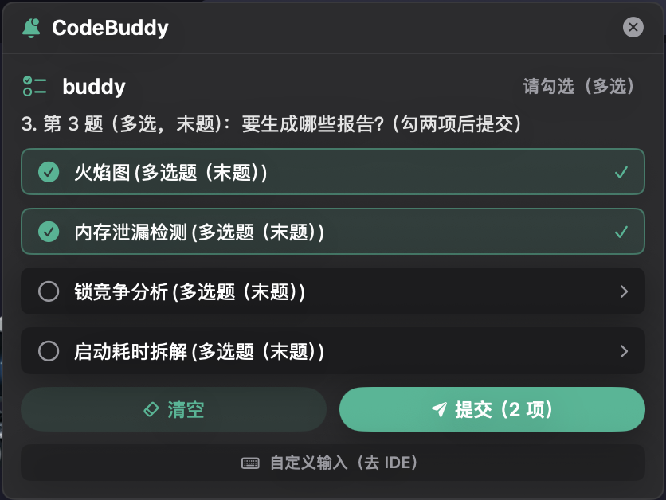 |

**其他面板**：

| 会话同步 | 积分看板 | 菜单栏 |
|---|---|---|
| 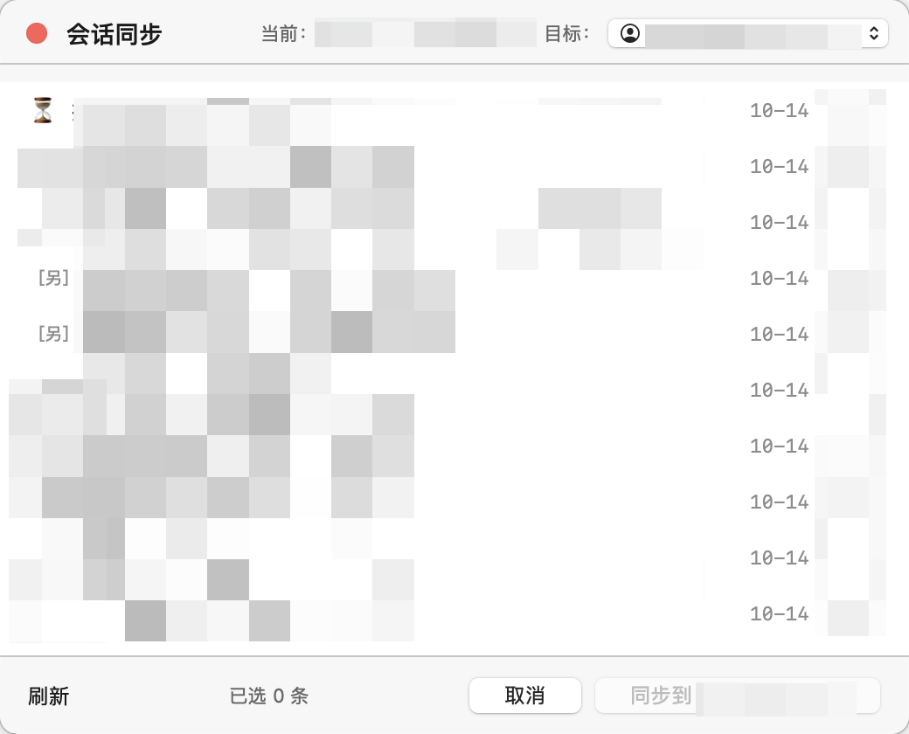 | 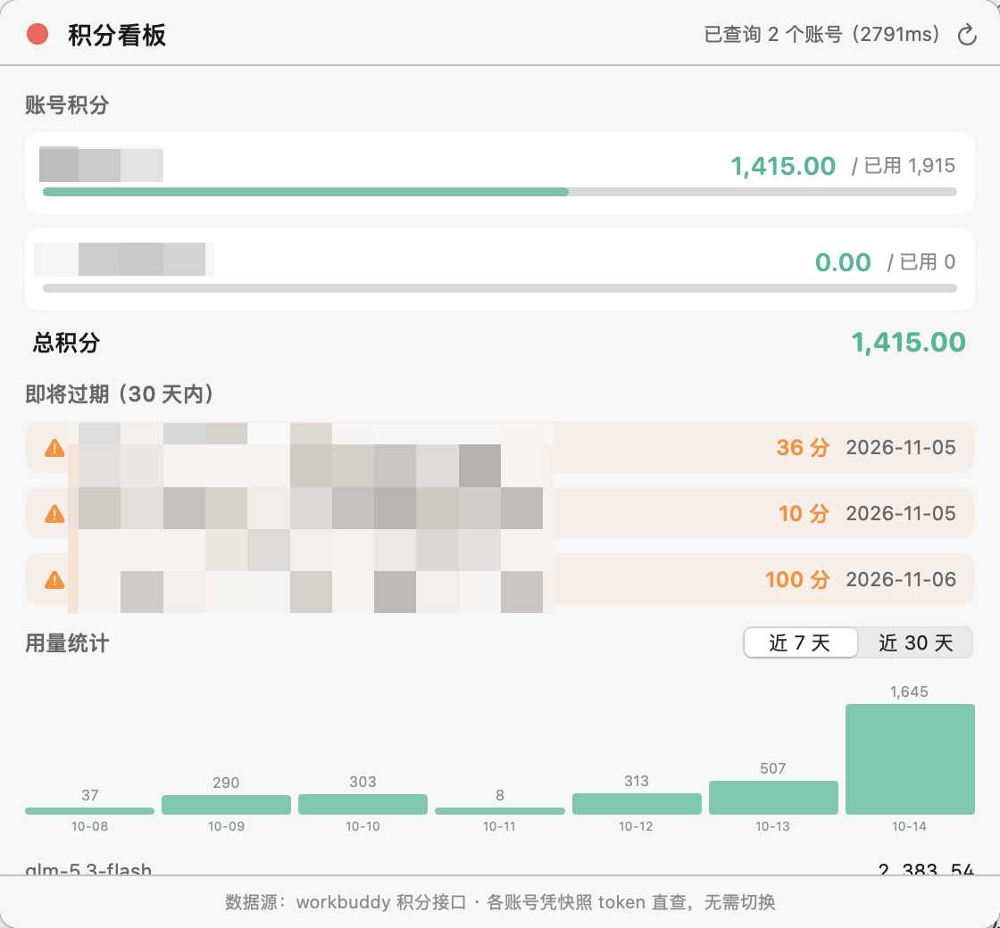 | 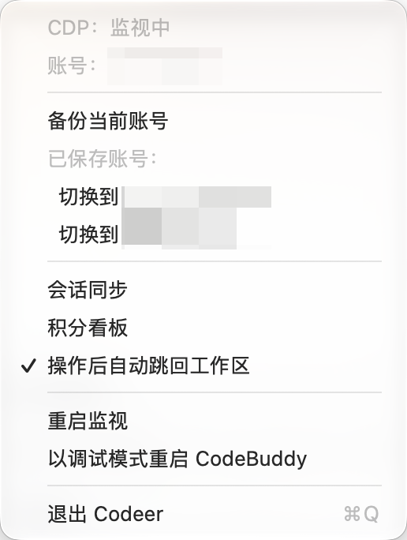 |

## 免责声明

- 本项目为**非官方**第三方工具，与 CodeBuddy / WorkBuddy 官方无隶属关系，未获得官方授权或认可；CodeBuddy 等名称与商标归其权利人所有
- 本项目会读取并改写 CodeBuddy 本地登录凭据（accessToken / refreshToken）以实现账号切换与积分查询，**请自行评估使用风险，凭据与数据全部保存在本机，不经过任何第三方服务器**
- 本项目仅供个人学习与效率工具用途，使用本项目产生的一切后果由使用者自行承担
- 请遵守 CodeBuddy / WorkBuddy 的用户协议与账号安全要求，因使用本项目导致的账号问题责任自负

## 开源协议

[AGPL-3.0-or-later](LICENSE)

本项目的账号切换、积分接口、会话迁移实现参考了 [WorkDaddy](https://github.com/babygoton/WorkDaddy)（AGPL-3.0），故本项目同样以 AGPL-3.0 协议开源。

## 致谢

- 思路来源：[DockTerm](https://github.com/munvard/dockterm) — Claude Code 的刘海区确认提醒
- 参考来源：[WorkDaddy](https://github.com/babygoton/WorkDaddy) — 账号切换、积分接口、会话迁移的实现参考

